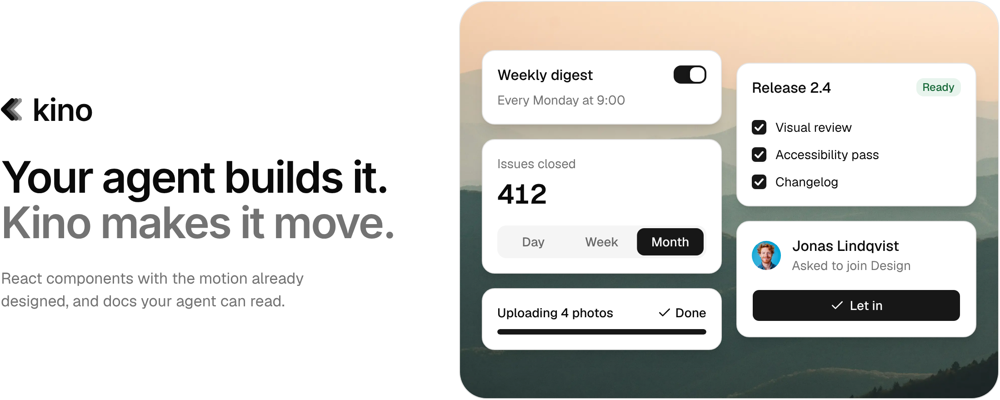

<picture>
  <source media="(prefers-color-scheme: dark)" srcset=".github/banner-dark.png">
  
</picture>

[Website](https://kinoui.com) · [Docs](https://kinoui.com/docs) · [Installation](https://kinoui.com/docs/installation)

## Install a component

Kino installs with the shadcn CLI into a React project that uses Tailwind CSS v4. Each component's page has its command:

```bash
npx shadcn@latest add https://kinoui.com/r/button.json
```

To add components by name, add the namespace once:

```bash
npx shadcn@latest registry add @kino=https://kinoui.com/r/{name}.json
npx shadcn@latest add @kino/button @kino/dialog
```

The code lands in your project, so you can change any line. The [installation guide](https://kinoui.com/docs/installation) says what each command adds, and how to install by hand.

## What's here

The source of every free component and block, as Kino's registry builds it. The CLI rewrites its imports and icons for your project when it installs it, and adds the global CSS each one needs:

- `registry/components/kino/`: the components, and the blocks in folders of their own.
- `registry/lib/`: the parts they build on, such as the motion tokens.

This repository is published from Kino's own, so pull requests can't be merged here. To report a bug, open an issue.

## Licence

[MIT](LICENSE)
